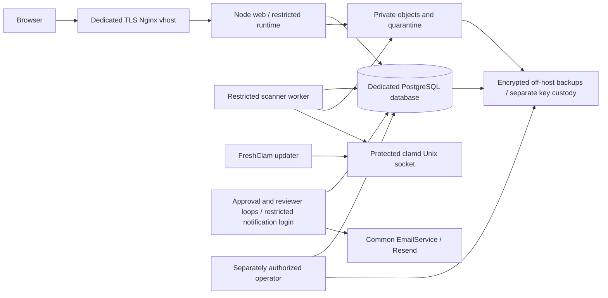

# Proposed production architecture and isolation

Phase 4, 6 November 2026 (Africa/Johannesburg). **Design only. No VPS, staging,
DNS, Nginx, PM2, firewall or external database change is authorized.** KBSK,
Q-Ahead and all existing applications/users/databases remain untouched. Michael's
original Lovable attribution and published history remain intact.

## Initial assessment

Implemented: live Better Auth cookies, verified/approved/consented account gates,
RLS, separate capabilities, exact-revision reviewer assignment, immutable history,
transactional outboxes, private audited streaming and fail-closed quarantine/hash
checks. Prior phase reports describe implementation evidence, not live acceptance.

Initially missing: a restricted email-worker connection and shared abuse limiting.
Phase 4 adds both. Initially unvalidated: real ClamAV/FreshClam, coordinated restore,
actual host isolation, supervised restart, off-host backup, external delivery and
human accessibility. The disposable encrypted restore drill supplies local recovery
evidence; it does not validate host backups or real antivirus. Legal/retention,
operational ownership, RPO/RTO and incident escalation require Diocese decisions.

## Proposed topology

Proposals, not existing VPS facts: `/srv/cape-vault/releases/<id>` plus an atomic
`current` link; `/var/lib/cape-vault/objects` private data; `/etc/cape-vault/` protected
per-process configuration; `/var/backups/cape-vault/` encrypted backups;
`/var/log/cape-vault/` restricted logs; web loopback port 3300. Validate capacity,
ports, users, PostgreSQL version and namespace collisions before provisioning.
Never reuse another application's credentials, backup root or PM2 daemon.

The web receives only runtime DB credentials, auth configuration and its email
provider configuration. Scanner credentials and operator credentials never enter
web handlers. Scanner receives scan DB/socket/storage configuration only. The
notification identity receives its DB connection, trusted application origin,
provider configuration and (reviewer delivery only) protected invitation key material.
Operator/migration credentials live outside every normal service environment.
The web needs Resend for verification/reset/test mail; notifications run separately.
Sender/reply-to/enabled flags resolve from PostgreSQL for every send. Application
links derive exclusively from BETTER_AUTH_URL.

The current storage provider requires root/files owned by its process UID and a
0700 root. **Different Linux UIDs cannot simply share this root using a group ACL.**
Do not weaken permissions or enable broad directory access to make that work.
Proposed hard isolation: separate web/scanner mount and PID namespaces, mapping the
storage owner consistently, scanner object mount read-only, separate secret mounts,
no access to each other's `/proc`, no host/container management socket and private
clamd socket access. Review this layout before confidential staging. A single shared
Unix UID under ordinary PM2 is only process separation and is insufficient as a
host-level secret boundary. PM2 must not collect all identities' secrets in one daemon
or saved process dump. Host sandbox implementation is a pending infrastructure gate.

PostgreSQL/ClamAV/FreshClam/Nginx remain native dependency services, independently
supervised. One bounded worker loop per kind; no overlapping cron/timer. Templates
in `ops/` are intentionally inactive and contain proposed placeholders. PM2 example
covers the web only; worker isolation needs the reviewed service boundary above.

## Release engineering

Build from a reviewed immutable revision with locked dependencies and supported
Node/Bun/PostgreSQL versions. Stage the build without private data or environment
files; run migration hash/RLS/grant audits and capture-only acceptance. Maintenance
quiesces web mutations and all worker loops before coordinated backup/migration.
Apply additive migrations with a separately authorized operator; verify grants twice;
start dependencies, validate scanner, reconcile objects, then workers/web. Switch the
release link only after checks. No automatic migrations, role grants or deployment
on web startup. Roll back application artifacts only when schema compatibility is
reviewed; keep applied forward migrations and immutable evidence. Never rewrite Git
or migration history. Final production launch needs separate explicit authorization.

The existing connection factories intentionally reject nonlocal targets. No remote
connection switch was added. Before an isolated nonlocal deployment, separately
review target-specific DB identity/ownership/TLS checks and operator tooling. This
is an explicit technical staging prerequisite, not an instruction to bypass guards.

See [roles](production-database-roles.md), [supervision](worker-supervision.md),
[recovery](backup-recovery.md) and the [readiness matrix](release-readiness.md).
